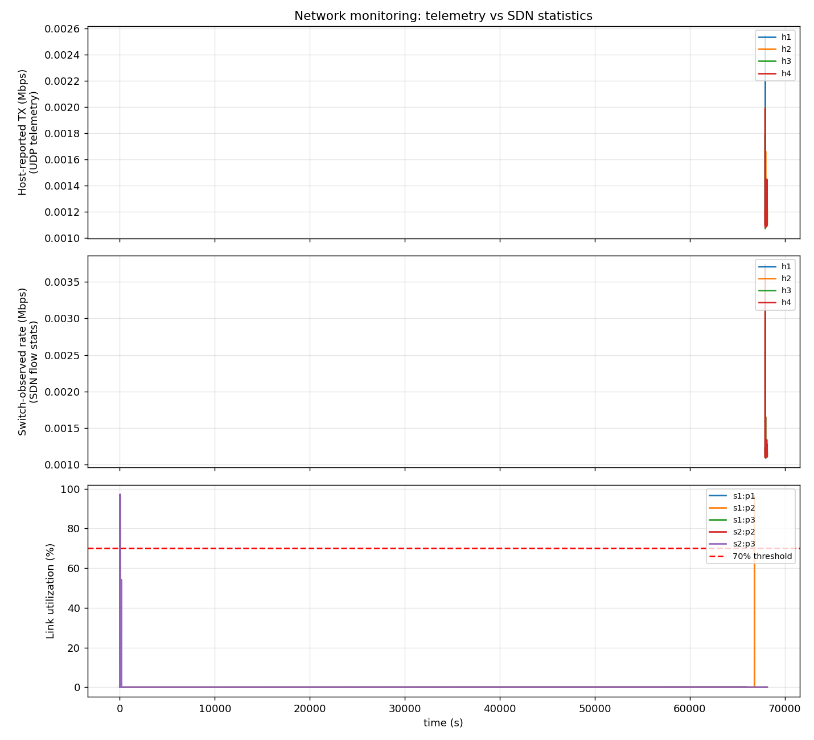

## 1. Objective

Build a distributed network-monitoring system in which hosts transmit telemetry over UDP sockets and an SDN controller combines that telemetry with OpenFlow flow/port statistics to detect abnormal conditions and raise alerts.

## 2. Topology and architecture

```
 h1 (10.0.0.1) --\                         /-- h3 (10.0.0.3)
                  s1 ======10 Mbps====== s2
 h2 (10.0.0.2) --/   |                     \-- h4 (10.0.0.4)
                     |
      root namespace 10.0.0.254
      Ryu controller + UDP monitoring server (port 9999)
```

All links are 10 Mbps (Mininet `TCLink`), so utilization = bits per second / 10,000,000. Switches are Open vSwitch speaking OpenFlow 1.3 to a Ryu remote controller.

**Data paths.** (1) Each host agent sends one JSON UDP packet per second (host, sequence number, tx/rx bit rate read from its own NIC counters) to the monitoring server. (2) Every 2 s the controller requests flow and port statistics from both switches. (3) The controller correlates both sources every 2 s.

## 3. Requirement-to-implementation mapping

| Requirement | Implementation |
|---|---|
| Implement UDP telemetry agents | `agent.py` (UDP socket, 1 packet/s per host) |
| Develop a centralized monitoring server | `_telemetry_server()` in `monitor_app.py` |
| Collect SDN flow statistics | `_poll_loop()`, `_flow_reply()`, `_port_reply()` (OFPFlowStats / OFPPortStats) |
| Calculate traffic utilization | `port_util` = (byte delta x 8 / interval) / link capacity |
| Define abnormality thresholds | Constants at the top of `monitor_app.py` (section 4) |
| Generate alerts | `_alert()` prints to console and writes `alerts.log` |
| Monitor multiple network nodes | 4 hosts + 2 switches monitored simultaneously |
| Present monitoring results | Console dashboard, `metrics.csv`, `results.png` |

## 4. Thresholds and reasoning

| Alert | Condition | Reasoning |
|---|---|---|
| HIGH_UTILIZATION | link utilization > 70% | Above ~70% queues build up and latency/loss increase |
| HOST_SILENT | no telemetry for 6 s | 6 missed 1 s reports means the host or its agent is down, not just jitter |
| TELEMETRY_LOSS | > 10% sequence-number gaps in last 20 s | Sequence numbers reveal lost UDP packets; 10% separates real loss from noise |
| HOST_FLOW_MISMATCH | host-reported rate and switch-observed rate differ by > 50% (and above 200 kbps) for 2 consecutive polls | Host says it sends traffic that the switches never see: blackhole or silent drop |

## 5. Test scenarios

| Scenario | Action | Expected alert |
|---|---|---|
| A | 1 Mbps UDP flow h1 to h4 | none (normal) |
| B | 9 Mbps UDP flow h1 to h4 | HIGH_UTILIZATION |
| C | Kill h3's agent, then restart it | HOST_SILENT, then cleared |
| D | Drop 80% of h2's telemetry packets with iptables | TELEMETRY_LOSS, then cleared |
| E | h1 sends 5 Mbps; drop rule installed on s1 | HOST_FLOW_MISMATCH |

Short transient mismatch alerts at the start/end of an iperf run are expected because the host (1 s) and controller (2 s) sampling windows are not aligned.

## 6. Results

### 6.1 Graph



### 6.2 Demo timeline (what was triggered, and when)
```
[DEMO 11:17:49] Agents started; waiting for telemetry to stabilise
[DEMO 11:17:59] SCENARIO A: normal traffic (1 Mbps h1->h4) - expect NO alert
[DEMO 11:18:17] SCENARIO B: congestion (9 Mbps on 10 Mbps links) - expect HIGH_UTILIZATION
[DEMO 11:18:39] SCENARIO C: host h3 agent killed - expect HOST_SILENT after ~6s
[DEMO 11:18:53] SCENARIO C: h3 agent restarted - alert clears
[DEMO 11:19:03] SCENARIO D: 80%% of h2 telemetry dropped - expect TELEMETRY_LOSS
[DEMO 11:19:28] SCENARIO D: telemetry loss removed
[DEMO 11:19:53] SCENARIO E: blackhole h1->h4 at s1 while h1 sends 5 Mbps - expect HOST_FLOW_MISMATCH
[DEMO 11:20:03] SCENARIO E: drop rule installed on s1
[DEMO 11:20:21] SCENARIO E: drop rule removed
[DEMO 11:20:41] DEMO FINISHED
```

### 6.3 Alerts generated by the monitor (alerts.log)
```
[11:18:19] ALERT HIGH_UTILIZATION switch s1 port 1 at 83%
[11:18:19] ALERT HIGH_UTILIZATION switch s1 port 3 at 83%
[11:18:19] ALERT HIGH_UTILIZATION switch s2 port 2 at 83%
[11:18:19] ALERT HIGH_UTILIZATION switch s2 port 3 at 83%
[11:18:34] CLEARED util 1 1
[11:18:34] CLEARED util 1 3
[11:18:34] CLEARED util 2 2
[11:18:34] CLEARED util 2 3
[05:51:17] ALERT HIGH_UTILIZATION switch s1 port 1 at 96%
[05:51:17] ALERT HIGH_UTILIZATION switch s1 port 2 at 96%
[05:51:27] CLEARED util 1 1
[05:51:27] CLEARED util 1 2
```

### 6.4 Sample of the console dashboard (results/ryu_output.txt)
```
=== 11:17:45 ===
HOST    TX Mbps   RX Mbps   FLOW Mbps    LOSS %


=== 11:17:47 ===
HOST    TX Mbps   RX Mbps   FLOW Mbps    LOSS %


=== 11:17:49 ===
HOST    TX Mbps   RX Mbps   FLOW Mbps    LOSS %


=== 11:17:51 ===
HOST    TX Mbps   RX Mbps   FLOW Mbps    LOSS %


=== 11:17:53 ===
HOST    TX Mbps   RX Mbps   FLOW Mbps    LOSS %


=== 11:17:55 ===
HOST    TX Mbps   RX Mbps   FLOW Mbps    LOSS %


=== 11:17:57 ===
HOST    TX Mbps   RX Mbps   FLOW Mbps    LOSS %


=== 11:17:59 ===
HOST    TX Mbps   RX Mbps   FLOW Mbps    LOSS %


=== 11:18:01 ===
HOST    TX Mbps   RX Mbps   FLOW Mbps    LOSS %
  link s1 port 1 utilization: 9.0%
  link s1 port 3 utilization: 9.0%
  link s2 port 2 utilization: 9.0%
  link s2 port 3 utilization: 9.0%

--
=== 11:18:03 ===
HOST    TX Mbps   RX Mbps   FLOW Mbps    LOSS %
  link s1 port 1 utilization: 10.8%
  link s1 port 3 utilization: 10.8%
  link s2 port 2 utilization: 10.8%
  link s2 port 3 utilization: 10.8%

--
=== 11:18:05 ===
HOST    TX Mbps   RX Mbps   FLOW Mbps    LOSS %
  link s1 port 1 utilization: 10.8%
  link s1 port 3 utilization: 10.9%
  link s2 port 2 utilization: 10.8%
  link s2 port 3 utilization: 10.9%

--
=== 11:18:07 ===
HOST    TX Mbps   RX Mbps   FLOW Mbps    LOSS %
  link s1 port 1 utilization: 10.8%
  link s1 port 3 utilization: 10.8%
```
